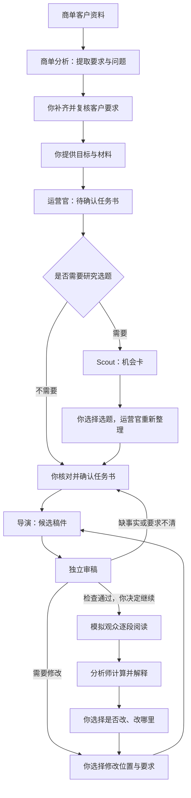

# 众幕 AI：七个子 agent 串联与完整使用说明

适用版本：2026-11-07，本地七角色组件＋六角色 Mock 文件交接演示＋商单分析到运营官的文件交接。没有前端。

## 1. 这个项目到底做什么

你给它一个创作目标和可使用的资料，它帮你整理需求、想选题、写稿、审稿，再让“模拟读者”逐段阅读，最后汇总哪里出现了疑问、退出以及可以尝试怎样改。

目前交付的是七个可以分别运行的角色，以及六角色**离线演示**与新增商单分析交接入口。还不是能无人值守完成全部业务的成品。它不会替你发布、收款、获得客户审批，也不会生成视频成片。

| 角色 | 大白话职责 | 交出的东西 |
| --- | --- | --- |
| 商单需求分析员 PR Analyst | 在创作前梳理客户资料、硬性要求和缺口 | 带原文出处的需求报告；条件具备时提供运营官待确认输入 |
| 运营官 Operator | 把你的想法整理清楚 | 待确认任务书 Brief、需要补充的问题 |
| 流量捕捉者 Scout | 根据你提供的材料提出选题 | 带材料引用的机会卡；没有实时上网查热点 |
| 内容导演 Director | 按已确认需求写稿、按指定范围改稿 | 三条标题、封面文案、分段正文；改稿附变化记录 |
| 独立审稿员 Reviewer | 按要求逐项检查 | 满足／不满足／无法判断，以及具体问题位置 |
| 模拟观众 Audience | 扮演不同读者逐段阅读 | 每个人看了什么、疑问、互动意向、是否退出 |
| 数据分析师 Analyst | 先计算数据，再解释观察 | 完整分母、退出统计、带事件引用的修改建议 |

Mock 是离线的固定模板；live 是调用真实模型。**Mock 跑通只能证明流程和格式能衔接，不能证明稿件写得好。真实模型扮演的读者也不是实际人类读者。**

## 2. 它们按什么顺序串联



不需要选题研究时可以跳过 Scout；不需要试映时可以在审稿、人工检查后结束。商单有固定选题时通常也跳过 Scout。

关键点：上一个角色的“结果文件”不能原封不动作为下一个角色的“输入文件”。需要取出任务书、材料、稿件、版本等相应字段，按下一个角色的格式组装。新加的 `tools/demo_team.py` 就是这个交接过程的可运行范例。

真实使用仍保留人工决定：复核商单提取、选题、确认需求、选定修改范围、最终接受稿件。当前输入中的 `confirmed=true` 是调用方声明，不是数据库已经核实的审批记录。商单分析本身不输出 confirmed=true。

## 3. 安装与第一次启动

下面命令在 Windows PowerShell 运行。普通使用不需要启动数据库、网页、微信或 GitHub。

这台电脑的项目目录：

```powershell
Set-Location 'C:\Users\52436\Desktop\黑客松项目开发\creator-agent-team\birthco-local'
```

首次安装：

```powershell
& "$env:LOCALAPPDATA\Programs\Python\Python313\python.exe" -m venv .venv
.\.venv\Scripts\python.exe -m pip install -r requirements-dev.lock
```

需要 Python 3.13 或更高版本。换电脑后先安装相应 Python；若 `python` 命令弹出应用商店，请使用实际安装的解释器路径。安装依赖需要网络，但不会调用创作模型。

后文的 `$py` 代表当前项目里的解释器，每开一个新窗口先执行：

```powershell
$py = Join-Path (Get-Location) '.venv\Scripts\python.exe'
```

不必激活虚拟环境，也不必修改 PowerShell 执行策略。命令报错时先停下来修正，不要连续运行后续步骤。

## 4. 一次看懂六个角色交接：离线演示

```powershell
$demoDir = 'demo-' + (Get-Date -Format 'yyyyMMdd-HHmmss-fff')
& $py tools/demo_team.py --input examples/team-demo.json --output-dir $demoDir --confirm-mock-demo
Get-Content -LiteralPath (Join-Path $demoDir '请先读我.md') -Encoding UTF8
```

这个入口**没有 live 参数**，不读取密钥、不请求模型接口。输出目录必须是新的；重复运行会拒绝覆盖旧文件。`--confirm-mock-demo` 只表示你知道这是机械演示，并不确认真实任务书或客户审批。

示例已预选 `opp_1`，演示会按它生成一个新的待确认任务书；原始目标保存在 00／01 文件，没有被悄悄覆盖。确认字段只是演示占位。

| 文件前缀 | 你可以看什么 |
| --- | --- |
| 00 | 完整演示输入，含预选选题和预设退出位置 |
| 01 | 运营官原始输入、待确认任务书 |
| 02 | Scout 的输入、选题卡和来源 |
| 03 | 根据预选机会卡重新生成的任务书 |
| 04 | 导演输入、模板稿件、版本号和内容指纹 |
| 05 | 审稿输入与结果；Mock 语义审稿会是 needs_input |
| 06 | 模拟观众场景、每次调用、全部会话事件 |
| 07 | 分析输入、完整程序统计与模板建议 |
| manifest.json | 整体演示状态、文件列表、未通过真实审稿等声明 |

特别注意：05 返回 `needs_input` 后，演示仍生成 06／07，**只为验证文件格式交接**。这条绕行只存在于 Mock 演示；不应复制到真实交付流程。

默认样例两个模拟读者、封面加一段正文，共四次本地 Mock 反应。`mock_exit_after=1` 预设读完第二个片段后退出；分析里的退出数来自这个设置。它不能用来证明内容不好。

成功时 `manifest.status=mock_demo_completed`，同时 `real_user_confirmed=false`、`editorial_quality_passed=false`、`real_workflow_complete=false`。如果缺材料、选错机会卡、结构规则失败，演示停在相应位置；若调用预算不足，保留未完成会话和分析统计。查看 `next_action`，修改输入后用新目录重跑。运行中不要手工改文件。

## 5. 七个角色分别怎么用

先建立结果目录；以下样例互相独立，**连续执行它们不等于串起同一个任务**。同一任务的交接看第 6 节和演示文件。

```powershell
New-Item -ItemType Directory -Path results -Force | Out-Null
& $py tools/run_operator.py --input examples/operator-task.json --output results/operator.json
& $py tools/run_scout.py --input examples/scout-task.json --output results/scout.json
& $py tools/run_director.py --input examples/director-task.json --output results/director.json
& $py tools/run_reviewer.py --input examples/reviewer-task.json --output results/reviewer.json
& $py tools/run_audience.py --input examples/audience-task.json --output results/audience.json
& $py tools/run_analyst.py --input examples/analyst-task.json --output results/analyst.json
```

新增商单分析的命令及与运营官的实际交接见第 8 节。它使用新结果文件，拒绝覆盖旧结果。

输入、输出都是 UTF-8 JSON。输出父目录要先存在。六个独立命令可以覆盖同名结果，正式使用请给每次运行取新文件名。

### 运营官：填好你的需求

复制 `examples/operator-task.json`，主要修改 `task` 里的内容：

- `account_id`：账号标识，使用英文字母、数字、下划线或短横线。
- `objective`：这次要解决什么问题；`audience`：写给谁看。
- `platform`：在哪个平台用；`style`：口吻和风格。
- `requirements`：必须满足的要求，至少 1 条、最多 30 条；每条使用稳定且唯一的 `id` 与明确的 `text`。
- `materials`：可引用的正文资料，最多 20 份。链接不会自动被读取；请提供有权限使用的正文，并声明 `authorized=true`。
- `length_rule`：正文长度上下限；不限制的项填 `null`。程序按非空白字符检查。

一般新稿使用 `input_mode="idea"`。材料类型：普通资料用 `source_text`，作者真实亲历才用 `user_supplied_experience`，旧稿用 `existing_draft`。所有材料合计不超过 80,000 字符，单份最多 20,000 字符。

输出的 `envelope.data` 是任务书，`questions` 和 `open_questions` 是待解决问题。运营官输出不等于用户已确认。

### Scout：有材料才能研究选题

需要账号定位、受众、风格、任务书和材料正文。输出最多三张机会卡。选择其中的 `id`，决定是否把 `angle` 变成新目标；之后重新整理并确认任务书。

它不会自己替你选题或改任务书，也不联网搜索。即使加 `--live`，也只是让模型分析已提供的材料；`evidence_date=null` 不代表已查到最新热点。

### 导演：写稿与局部改稿

新稿需要已确认任务书、正式 Brief 指纹、冻结规则、风格、准确对应的材料和预留段落编号。示例指纹已经配好；修改 Brief 或规则后必须重新计算。

看 `envelope.data` 中的 `titles`、`cover_copy`、`segments`。看 `rule_report.passed` 和 `next_action`：结构通过才进入独立审稿，不能据此接受或发布。

### 审稿员：检查，不重写

输入同一份任务书、原始材料和冻结稿件。输出要求核对 `requirement_checks`、事实依据核对 `claim_checks`、具体问题 `issues`，结论是 `pass`、`revise` 或 `needs_input`。

Mock 无法判断真实语义。结构合格时返回 `needs_input` 是预期行为；结构错误会给出 `revise`。不要把命令执行成功当作审稿通过。

### 模拟观众：逐段阅读

输入冻结稿件和 1～6 个 persona（模拟读者设定），每个设定有独立 `id`、阅读目标 `goal`、知识背景 `knowledge`、偏好 `preferences`。

每个读者依次看到封面和正文；首次调用看到封面，之后只看到当前片段、之前看过的片段和自己的反应，不会提前看全文。退出后不会继续看后文。

场景最多 8 个片段，**包含封面**，因此当前最多 7 段正文；超限会拒绝，不会偷偷截断。`max_calls` 是整个场景的调用次数上限（1～48），不是每个读者的额度。读者数乘片段数可估算无提前退出时的最大次数。`max_active_seconds` 为本地时间预算，上限 1200 秒；不是可强制杀停所有远程请求的后台看门狗。

结果 `COMPLETED` 包括“明确退出”这种正常结束；`INCOMPLETE` 或 `INTERRUPTED` 需要查看停止原因，不能当成观众不喜欢。重跑会建立新会话，不会自动接着上次跑。

### 分析师：先保存数字，再讨论解释

必须同时传入同一场模拟的完整输入 `source` 与完整报告 `simulation`。不要只给统计截图、节选事件或混入其他版本。

程序先验证记录，再计算：N 全部会话、S 已有阅读事件、C 正常读完、U 未完成、Z 零事件、exited 明确退出。Z 可能包含在 U 中，不要相加当总人数。阅读完成比例为 C/S；无有效分母返回 null。点赞、评论、收藏是模拟意向，以会话去重。

模型只解释数字和事件；失败时也保留有效统计。建议不会自动发给导演。版本比较需要两套独立记录并显式 `allow_descriptive_comparison=true`，当前只支持描述比较，不能声称同条件实验或某次改稿造成提升。

## 6. 开发者接入：准确的交接方式

| 从哪里 | 交给哪里 | 必须做的转换 |
| --- | --- | --- |
| 商单分析 task_draft | 运营官 | 人先复核提取结果，再用 CLI --handoff-output 生成的 {task: ...} 文件；有缺口／冲突时不会生成 |
| CreateTask | 运营官 | 验证 `CreateTask` 后运行；旧稿另传 edit_scope |
| 运营官 `envelope.data` | Scout `brief` | 另提供账号信息和带正文、授权声明的材料；用 `material_snapshot(task)` 保持材料 ID 一致 |
| Scout 机会卡 | 新任务 | 人选卡片；复制任务生成新 objective，重新运行运营官并确认；不要静默修改原始需求 |
| 已确认 Brief | 导演 | 用 `brief_hash(brief, frozen_rules)` 计算正式指纹；补风格、精确材料和新段落 ID 池 |
| 导演结果 | 审稿 | 抽取三标题、封面、正文，绑定该输出的 version_id、content_hash；带同一 Brief 和材料 |
| 通过核对的候选稿 | Audience | 转成 ContentDelivery；加入 persona、片段／调用／时间预算，不传完整导演输出 |
| Audience 输入＋输出 | Analyst | 原样绑定 `source` 和 `simulation`；不删失败和零事件会话 |
| 审稿／分析建议 | 导演改稿 | 用户挑选建议，转成授权的 Issue；提供基线、修改范围、新编号，重新审稿 |

材料交接：Operator 的 `material_index` 不含正文，不足以直接传给导演。应保存原始材料，用 `material_snapshot(task)` 得到稳定 `material_id`，导演和审稿只接收 `material_id/kind/label/text`；Scout 另外需要 `authorized/source_url`。不能把带额外字段的对象直接塞进严格输入格式。

下面是导演输入的核心组装方式（Python，调用前应由可信调用方核实真实确认）：

```python
from backend.agents.director import DirectorInput
from backend.agents.operator import material_snapshot
from backend.domain.hashing import brief_hash
from uuid import uuid4

# task 是验证后的 CreateTask；brief 是用户核对后的 Brief；user_confirmed 由调用方提供。
if user_confirmed is not True:
    raise ValueError("先确认需求，再生成内容")
rules = {"rule_version": "content-rules-v1", "title_count": 3, "max_body_characters": 20000}
materials = [
    {k: m[k] for k in ("material_id", "kind", "label", "text")}
    for m in material_snapshot(task)
]
director_input = DirectorInput(
    confirmed=True, brief=brief, brief_hash=brief_hash(brief, rules),
    frozen_rules=rules, style=task.style, materials=materials,
    reserved_segment_ids=["s_" + uuid4().hex for _ in range(7)],
)
```

运营官 `proposal_hash` 只对任务书提案计算，**不能代替**上述正式 `brief_hash`。内容指纹统一使用 `backend.domain.hashing.content_hash(content)`，不要对文件字节直接散列，也不要手填假指纹。指纹用于检查内容是否一致，不是权限认证或事实证明。

导演输出中 `version_id`、`content_hash` 与正文是一套快照。改了一个字也要生成新版本和新指纹，下游重新绑定；不能沿用旧观众报告。旧稿输出的 `change_log` 保留作审计，但传给审稿和观众时只抽取 `titles/cover_copy/segments`，否则严格格式会拒绝。

`tools/demo_team.py` 给出了全部实际字段转换；它只支持新稿和 Mock。正式业务需要另接可信的确认、存储、任务状态与预算控制，不能删掉演示标记后直接改成自动真实生产流程。

## 7. 怎样根据反馈改稿

先运行已经配好的局部改稿样例：

```powershell
& $py tools/run_director.py --input examples/director-revision-task.json --output results/revision.json
```

真实旧稿流程：

1. 把当前正文作为一份 `existing_draft` 材料；按空白行分段后必须与基线 `base_content.segments` 的文字逐字一致，标题封面不混入原稿正文材料。
2. 在运营官输入中用 `input_mode="existing_draft"`，另给 `edit_scope`：可改段 `target_segment_ids`、须保留段 `preserve_segment_ids`、标题和封面能否改。
3. 人工确认修改后的任务书，冻结完整旧版本 `base_version_id/base_content_hash/base_content`。
4. 导演还需要 `edit_requests`：每项有 `id/severity/location/reason/requested_change`。同一位置多条意见合成一项；来源可以是审稿问题，也可以是用户选中的分析建议。
5. 替换／新增段落用新的预留编号。未授权段落的编号、类型、原文和引用全部保留。输出完整新稿和 `change_log`，再次独立审稿。

分析师 finding 不能直接当成改稿授权。用户需决定改哪里、怎么改；当前导演日志关联的是选定的 `issue_id`，并要求 `finding_id=null`。如要保留 finding 与用户选择的关系，调用方另存映射。

## 8. 截图中的商单／PR 需求分析怎么处理

这里的 PR 指品牌宣传／公关文案需求。**独立的第七个商单需求分析 agent 已实现**，在运营官之前梳理资料、明确要求和问题。它整理的是客户提供的信息，不核实外部事实或自动取得审批。

推荐顺序：

> 客户资料 → 商单需求分析员 → 人补齐并复核 → 运营官整理 → 人确认 → 导演写稿 → 审稿逐项核对 → 人／客户审核 → 指定范围改稿。

先运行虚构客户资料样例（结果路径必须不存在，results 目录已创建）：

```powershell
& $py tools/run_pr_analyst.py --input examples/pr-analysis-task.json --output results/pr-analysis.json --handoff-output results/pr-operator-input.json
```

看 `pr-analysis.json`：六项核心字段品牌、产品、目标、受众、平台、风格缺失，要求为空，或仍有已报告冲突／问题时，返回 needs_input，task_draft=null，不创建交接文件。输入 `examples/pr-analysis-missing.json` 可验证该路径。

如果输出 ready_for_operator=true，先人工检查提取是否准确、是否遗漏矛盾。复核后再交给运营官：

```powershell
& $py tools/run_operator.py --input results/pr-operator-input.json --output results/pr-operator-proposal.json
```

这仍只生成**待确认任务书**。需要用户确认后才能交给导演。商单有固定选题时通常无需 Scout。

输入复制 `pr-analysis-task.json`：客户简报放 client_brief（label/text/authorized=true）；已明确的信息放 intake；已明确要求放 requirements；补充资料放 materials；字数限制放 length_rule。不知道的 intake 字段填 null。budget、deadline、approver 可选，只记录原话；未提供会另列清单，不等于商业条件已具备。更详细规则见 [PR_ANALYST.md](PR_ANALYST.md)。

品牌／产品字段不会自动变成正文必写要求；如果客户要求文案必须出现名称，应在 requirements 中明确写出。

Mock 只整理显式字段，不理解自由文本；真实模式才让模型提取原文引用、冲突和问题，质量尚未验收。模型不能改写已给字段或原 requirement 的 ID／文字，未知引文会报错。不保证穷尽冲突。ready_for_operator 只代表输入格式可交接，completeness_verified 与 commercial_approval 始终为 false。

如果客户要求已经由人整理好，仍可跳过分析员直接使用旧模板：

```powershell
& $py tools/run_operator.py --input examples/pr-operator-task.json --output results/pr-brief.json
```

下面表格描述最终运营官 CreateTask 的映射；商单分析员会自动生成这个格式：

| 客户提供的信息 | 填哪里 |
| --- | --- |
| 传播目标和本次交付目标 | objective |
| 目标人群 | audience |
| 发布渠道 | platform |
| 品牌口吻、表达限制 | style，同时把硬性限制写 requirements |
| 品牌名、必须出现的卖点、指定用语、合作披露、CTA、标签、禁用表述 | requirements，每项独立稳定 ID，尽量保留原文 |
| 客户简报、产品说明、可引用依据 | materials，通常 source_text |
| 正文字数 | length_rule；标题等特殊限制另写 requirements |
| 客户原稿与修改意见 | existing_draft＋edit_scope＋选定 Issue，按第 7 节 |
| 预算、排期、审核人 | 商单分析 intake 中可记录原话，再作为资料交给运营官；没有自动执行流程 |
| 合同、付款、客户审批状态 | 人工记录在外部业务台账；当前角色不作确认或执行 |

开始前先由人确认：品牌／产品是什么、写给谁、要传达什么、哪些必须写／不能写、事实依据在哪里、哪些资料有使用权限、最终谁审核。信息缺失就先补，不要让模板瞎编。

重要限制：Mock 运营官主要按原输入整理，不保证发现所有缺失或矛盾；真实模型也尚未做商单质量验收。`source_refs` 有效只说明引用了提供的材料，不证明产品功效、价格或客户承诺是真的。`authorized=true` 也是提供方的声明，组件不检查真实授权文件。

商单分析员也不自动理解合同效力、推断隐藏商业目标、报价、核实商品事实、收款、发布或获得客户审批。逐字引用只说明客户资料里出现过这句话，不能证明语义正确、商品功效真实或真实授权成立。分析报告和原始输入应一起保存；PR 的 source_id 与运营官的 material_id 各自保留映射。

## 9. 真实模型与费用

默认全部 Mock，不会产生模型调用费用。本次安装、测试与演示也没有发送真实模型请求。

真实模式使用现有百炼 Qwen 适配器。先在自己的百炼账号中确认可用模型 ID、地域、额度与计费；仓库默认配置是 `qwen3.8-flash` 和北京兼容接口，此默认值不保证你的账号可用。模型可用性、价格由供应商控制，以账号当前显示为准。

每次打开 PowerShell 后设置进程环境变量。**仅复制 `.env.example` 不会自动生效**，当前命令没有自动加载 `.env`。

```powershell
$secret = Read-Host '在本机输入百炼 API Key' -AsSecureString
$env:DASHSCOPE_API_KEY = [System.Net.NetworkCredential]::new('', $secret).Password
$env:QWEN_MODEL_ID = 'qwen3.8-flash'
$env:QWEN_BASE_URL = 'https://dashscope.aliyuncs.com/compatible-mode/v1'
```

只有明确加 `--live` 的单角色命令才会走真实适配器，例如：

```powershell
& $py tools/run_operator.py --input examples/pr-operator-task.json --output results/pr-brief-live.json --live
```

这会尝试一次可能计费的真实请求。商单分析、运营官、Scout、导演、审稿、数据分析各最多一次请求，可能因本地校验或缺资料提前零请求；观众按片段／persona 多次请求，最多 `max_calls` 次。失败或网络结果未知也可能已经发生供应商费用，不能假定没输出就免费。程序不自动重试；也没有全流程的硬金额上限、统一 Token 预留账本或真实账单验收。

使用完可清除当前窗口的密钥变量：

```powershell
Remove-Item Env:DASHSCOPE_API_KEY -ErrorAction SilentlyContinue
$secret = $null
```

不要把密钥填入需求材料、发到聊天、写入源码或备份包。需要真正文案质量时，应逐角色检查真实输出；不能只在离线演示后加一个参数就宣称完整真实流程已验证。

## 10. 看见报错怎么处理

| 现象 | 含义与处理 |
| --- | --- |
| 找不到 Python／模块 | 回到第 3 节；确认当前目录、解释器和依赖安装 |
| 找不到输入或无法保存输出 | 检查路径；独立角色的结果父目录先建好 |
| 演示输出目录已存在 | 使用新的目录名；程序不覆盖旧演示 |
| `needs_input` | 查看 questions／next_action，补材料或明确决定；不等于程序崩溃 |
| 审稿 Mock 一直待核实 | 正常；它不能做语义判断，需人工核对或配置真实模式 |
| brief/content hash 不匹配 | 内容或规则被修改，按第 6 节重建快照；不要改校验代码来绕过 |
| 素材引用未知、额外字段不允许 | 只传下个角色需要的字段；材料 ID 和 Brief 保持一致 |
| 观众片段数超限 | 封面也占一个片段；显式整理成最多 7 段正文，作为新内容重新绑定 |
| 预算不足、INCOMPLETE | 保留所有会话；检查停止原因，需要时明确建立新的请求，不伪装完成 |
| unknown／INTERRUPTED | 远端是否完成不明；先查供应商调用和费用，再决定是否新建一次请求 |
| 分析失败但仍有 metrics | 数字已计算并保留，解释没有成功；不要删掉失败报告 |
| live 缺密钥／模型不可用 | 确认当前窗口环境配置、模型权限和地域；不会悄悄用 Mock 冒充真实结果 |

退出码：通常 0 表示命令正常产出结果，1 表示领域错误，2 表示输入／配置／命令参数错误；商单分析、Audience 与 Analyst、整链演示还会用 3 表示未完成或失败。**退出码 0 不等于审核通过，也可能产出 needs_input。** 独立角色以各自结果字段为准。

## 11. 怎样验证确实能用

```powershell
& $py -m pytest -q
& $py tools/export_contracts.py --check
```

再跑第 4 节演示，逐项看：

1. 04、05、06、07 的版本／内容指纹能对应；07 的 source 是 06 原始输入，simulation 是完整输出。
2. 05 Mock 审稿依然待核实，manifest 没把它写成真实审核通过。
3. 06 每个读者的事件连续，退出后没有后文；07 保留未完成和零事件。
4. 改小 max_calls 后会保存未完成结果，而不是把缺失会话丢掉。
5. 改稿只改授权位置，原稿与新稿分开保存。

测试和离线演示验证程序行为；真实模型质量、真实读者反馈和实际商单验收需要另做，不应把测试通过当成这些效果已证明。

## 12. 本地保存、以后上传与剩余工作

当前源代码保存在 `creator-agent-team`，最新本地交付包是项目旁 `deliverables/creator-agents-v8.zip`；配套 `.bundle` 保存 Git 历史。解压 ZIP 后进入 `birthco-local`，重新安装依赖。ZIP 不包含 Python 环境、模型密钥和退役前端。旧 v7 是新增商单分析前的六角色版本。

需要恢复 Git 历史，可在一个新的目录执行（先把下面路径替换为备份实际位置）：

```powershell
git clone 'C:\Users\52436\Desktop\黑客松项目开发\deliverables\creator-agents-v8.bundle' creator-agent-restored
```

普通 Git 提交不会自动保存未跟踪的运行结果。需要留存某次任务时，把输入、全部输出、决定记录一起备份，避免只保留最后一份稿件。演示目录与独立结果可能含客户资料，分享前先检查内容。

目前不使用原 GitHub 仓库。以后仓库恢复后，再从本地 Git 配置目标仓库并推送；当前说明不会触发上传，也没有发送微信消息。

尚待集成：正式持久化调度器、真实用户确认与账号归属校验、角色生产自动交接、统一调用预算和账本、记忆检索、完整实验条件／恢复机制、真实模型质量验收。后端数据库／接口基础模块已存在，但不代表七角色已经被持久化调度。当前增加了商单分析到运营官的文件交接，六角色 Mock 演示入口仍是离线范例，前端不在交付范围。

更细的单角色规则见同目录 `PR_ANALYST.md`、`OPERATOR.md`、`SCOUT.md`、`DIRECTOR.md`、`REVIEWER.md`、`AUDIENCE.md`、`ANALYST.md`。历史方案中若提到 MiMo、前端或未来能力，以当前范围与本文的已完成／未完成说明为准。
