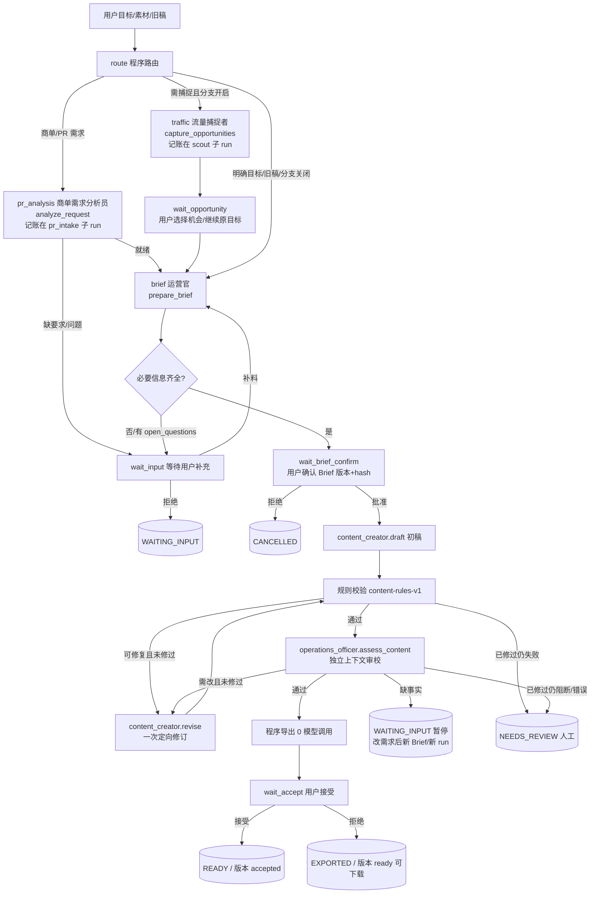
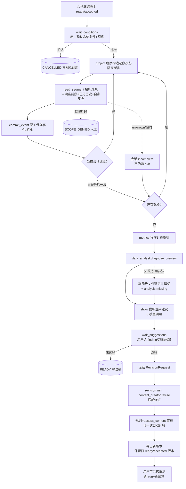

# 交付物 1 · 总流程图与节点、条件边表

seven-agent.v0.1 编排（LangGraph StateGraph，按 run.kind 固定图）。业务角色固定七个，
编排层是确定性控制器：模型输出的 next_agent/goto/“已获批准”不参与调度。

代码入口：[graph.py](../../backend/workflow/five_agent/graph.py)、
[nodes.py](../../backend/workflow/five_agent/nodes.py)。
机器可读契约：[agent-interface.json](../../backend/workflow/five_agent/resources/agent-interface.json)。

## 1. A 主链：内容交付（run.kind = content）

## 2. B 可选试映与局部改稿（run.kind = preview → revision）

## 3. 节点表

| 图 | 节点 | 执行方 | 调用的 action | 产出/落库 | 预算 |
|---|---|---|---|---|---|
| content/revision/scout | route | 程序 | — | route_decision | 0 |
| content/pr_intake | pr_analysis | pr_analyst | analyze_request | RequestAnalysis artifact（pr_intake 子 run 记账；要求并入 Brief） | pr_intake: 3+1 |
| content/scout | traffic | traffic_scout | capture_opportunities | OpportunitySet artifact（scout 子 run 记账） | scout: 3+2 |
| content | wait_opportunity | 用户闸门 | — | opportunity_selection artifact | 0 |
| content | brief | operations_officer | prepare_brief | Brief（task_id+version+hash 复合引用） | content 正常 |
| content | wait_input | 用户闸门 | — | 补料入任务（原预算继续） | 0 |
| content | wait_brief_confirm | 用户闸门 | — | confirm_brief（CAS 绑定版本/hash） | 0 |
| content | draft | content_creator | draft | ContentCandidate → candidate 版本 | content 正常 |
| content/revision | rules | 程序 content-rules-v1 | — | RuleReport artifact | 0 |
| content/revision | review | operations_officer | assess_content | EditorialReview artifact | content/revision 正常 |
| content/revision | repair | content_creator | revise（≤1 次业务修订） | Revision → 新版本（base 保留） | 正常 +1 对 |
| preview | wait_conditions | 用户闸门 | — | 冻结 preview artifact + sessions | 0 |
| preview | project | 程序 | — | 投影校验（未来/跨会话隔离断言） | 0 |
| preview | audience_step | simulated_audience | read_segment | AudienceEvent（经 commit 校验） | preview ≤48 |
| preview | commit_event | 程序 | — | 事件+游标原子提交 | 0 |
| preview | advance | 程序 | — | 会话/序号调度 | 0 |
| preview | metrics | 程序 | — | Metrics artifact | 0 |
| preview | analysis | data_analyst | diagnose_preview | Analysis artifact（finding 须引用真实事件） | preview ≤1 |
| preview | show | 程序模板 | — | suggestions artifact | 0 |
| preview | wait_suggestions | 用户闸门 | — | RevisionRequest artifact | 0 |
| content/revision | export | 程序 | — | export_batch（MD/TXT），版本→ready | 0 |
| content/revision | wait_accept | 用户闸门 | — | 版本→accepted 或保持 ready | 0 |
| 全部 | needs_review / stop | 程序 | — | 终态 | 0 |

## 4. 条件边表

| 来源 | 条件（程序判定，非模型输出） | 目标 | 终态 |
|---|---|---|---|
| START | 持久化 resume_step（恢复入口映射） | route / pr_analysis / draft / rules / … | — |
| route | purpose=commercial_order 或带 client_brief | pr_analysis | — |
| pr_analysis | ok 且 ready_for_operator | brief | — |
| pr_analysis | ok 但缺要求 / needs_input | wait_input（补料后回 pr_analysis） | — |
| pr_analysis | error（不交接） | needs_review | NEEDS_REVIEW |
| route | 启用捕捉 且 无明确目标/旧稿 且 能力已接入 | traffic | — |
| route | 明确目标/已有旧稿/分支关闭（记录 traffic_skipped） | brief | — |
| traffic | ok | wait_opportunity | — |
| traffic | 失败且非“发现选题”目的（记录跳过） | brief | — |
| traffic | “发现选题”目的且失败 | needs_review | NEEDS_REVIEW |
| wait_opportunity | 批准（选择机会或继续原目标） | brief | — |
| wait_opportunity | 拒绝 | stop | CANCELLED |
| brief | ok 且 open_questions 为空 | wait_brief_confirm | — |
| brief | ok 但有 open_questions / needs_input | wait_input | — |
| brief | error | needs_review | NEEDS_REVIEW |
| wait_input | 批准补料（同 run 继续计费） | brief | — |
| wait_input | 拒绝 | stop | WAITING_INPUT |
| wait_brief_confirm | 批准且 payload 匹配冻结版本+hash | draft | — |
| wait_brief_confirm | 拒绝 / hash 不符 | stop / 异常 | CANCELLED / FAILED |
| draft | ok | rules | — |
| draft | needs_input（确认后缺事实） | stop | WAITING_INPUT |
| draft | error / 技术重试耗尽 | needs_review | NEEDS_REVIEW |
| rules | 通过 | review | — |
| rules | 可修复且 repair_count=0（跳过首次审校） | repair | — |
| rules | 已修过仍失败 | needs_review | NEEDS_REVIEW |
| review | overall=pass | export | — |
| review | overall=revise 且 repair_count=0 | repair | — |
| review | overall=revise 已修过 | needs_review | NEEDS_REVIEW |
| review | overall=needs_input（缺事实） | stop | WAITING_INPUT |
| repair | ok（修订计数 +1） | rules | — |
| repair | error / scope 越权 | needs_review | NEEDS_REVIEW |
| export | 版本→ready | wait_accept | — |
| wait_accept | 接受 | stop | READY（accepted） |
| wait_accept | 拒绝 | stop | EXPORTED（ready 可下载） |
| wait_conditions | 批准（冻结场景+预算） | project | — |
| wait_conditions | 拒绝 | stop | CANCELLED |
| project | 投影合法 | audience_step | — |
| audience_step | ok 且 event.segment_id=当前段 | commit_event | — |
| audience_step | unknown/超时（会话→incomplete，不伪造 exit） | advance | — |
| audience_step | 越域片段（SCOPE_DENIED，计费不写事件） | needs_review | NEEDS_REVIEW |
| commit_event | exit→会话 exited；末段→completed | advance | — |
| advance | 当前会话有下一段 / 其他会话 active | project | — |
| advance | 全部会话终态 | metrics | — |
| analysis | ok 且 finding 引用合法 | show | — |
| analysis | 失败/引用非法（软降级） | show | — |
| wait_suggestions | 批准且 finding_ids 非空 | stop（创建 revision run） | READY |
| wait_suggestions | 未选择/拒绝 | stop | READY（零改稿） |

错误/取消公共规则：任意节点入口、发送前、提交前都做 epoch/取消 fence；迟到结果只记
usage=discarded，不覆盖版本；模型返回的路由文本永不进入上表。
